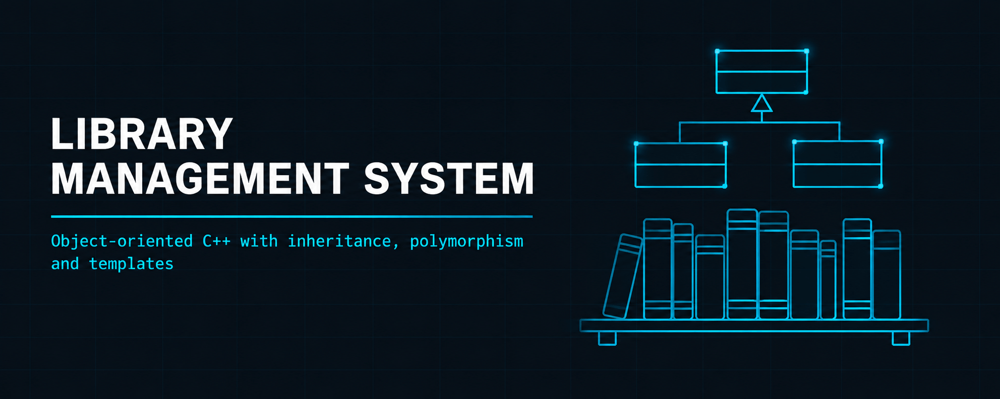
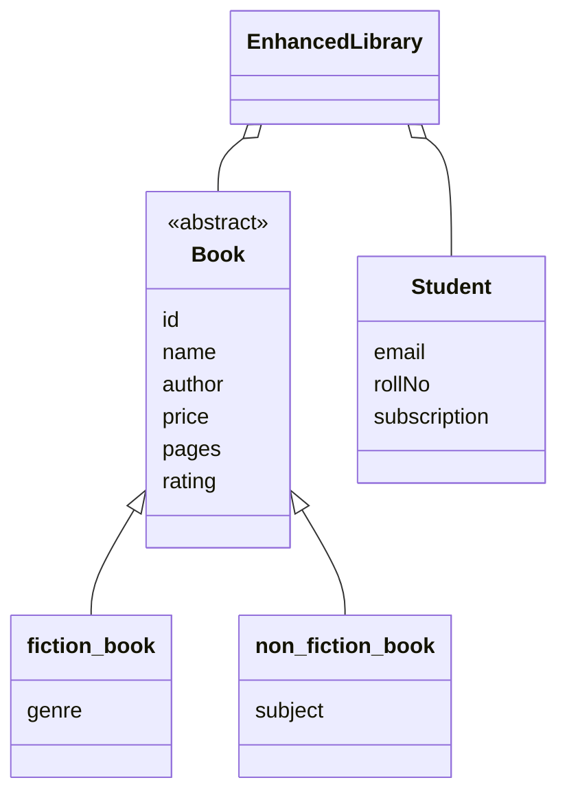

<p align="center">
  
</p>

<h1 align="center">Library Management System</h1>

<h3 align="center">Object-oriented C++ with inheritance, polymorphism and templates</h3>

<p align="center">
  
  
  
  
</p>

<p align="center">
  <a href="#overview"><b>Overview</b></a> ·
  <a href="#features"><b>Features</b></a> ·
  <a href="#screenshots"><b>Screenshots</b></a> ·
  <a href="#oop-design"><b>OOP Design</b></a> ·
  <a href="#data-files"><b>Data Files</b></a> ·
  <a href="#build--run"><b>Build</b></a>
</p>

---

## Overview

A console-based library management system written in C++. An administrator manages the book catalogue and a student registers, logs in, and borrows and returns books. The project was built to apply the main object-oriented concepts in one program: inheritance, polymorphism, operator overloading, templates and dynamic memory.

| | |
| --- | --- |
| **Language** | C++ (C++11 or later) |
| **Interface** | Console menus |
| **Roles** | Administrator and Student |
| **Book types** | Fiction (genre) and Non-Fiction (subject) |
| **Storage** | Book catalogue loaded from text files in `Data/` |
| **Compilers** | GCC, MinGW, MSVC |

## Features

| Administrator | Student |
| ------------- | ------- |
| Log in with admin credentials | Register with a subscription plan |
| Add fiction and non-fiction books | Log in with email and password |
| Display all books | Issue books from the library |
| View fiction books with genre and rating | Return books to the library |
| View non-fiction books with subject and rating | See subscription status after login |
| View registered students | |

**Subscription plans**

| Plan | Price |
| ---- | ----- |
| Basic | Free |
| Premium | $10 / month |
| Premium Plus | $20 / month |

## Screenshots

| | |
| --- | --- |
|  |  |
| <sub>Admin dashboard</sub> | <sub>Add a fiction book (genre and rating)</sub> |
|  |  |
| <sub>Complete library catalogue</sub> | <sub>Fiction collection</sub> |
|  |  |
| <sub>Student login</sub> | <sub>Student registration</sub> |

## OOP Design



| Concept | Where it is used |
| ------- | ---------------- |
| **Classes and objects** | `EnhancedLibrary` (library logic), `Book`, `fiction_book`, `non_fiction_book`, `Student` |
| **Inheritance** | `fiction_book` and `non_fiction_book` derive from the base class `Book` |
| **Polymorphism** | Virtual functions with runtime binding on book objects |
| **Operator overloading** | Assignment `=`, comparison `==` `!=` `<` `>`, stream insertion `<<` |
| **Templates** | Generic dynamic array, template functions for sorting and searching |
| **Dynamic memory** | Auto-resizing arrays, deep-copy constructors, cleanup in destructors |

Other implementation details: integer and string input validation, and text-file parsing with error handling.

## Data Files

The starting catalogue is read from two text files in `Data/`. Each book uses one line per field, in this order.

| `fiction.txt` | `nonfiction.txt` |
| ------------- | ---------------- |
| Book ID | Book ID |
| Book name | Book name |
| Author name | Author name |
| Price | Price |
| Pages | Pages |
| Rating | Rating |
| Genre | Subject |

## Demo Credentials

These accounts are built into the program for testing.

| Role | Email | Password |
| ---- | ----- | -------- |
| Administrator | `abdul@gmail.com` | `abdul` |
| Student (Premium, roll no. 1001) | `shoaib@student.com` | `shoaib123` |

Credentials are stored in the program for demonstration only. A real system would store hashed passwords.

## Build & Run

Source files and data files are in `Data/`. Compile from inside that folder so the program finds `fiction.txt` and `nonfiction.txt`.

```bash
git clone https://github.com/abdul-wahid022/Library-Vault-OOP.git
cd Library-Vault-OOP/Data
g++ -std=c++11 enhanced_main.cpp enhanced_library.cpp enhanced_globals.cpp book.cpp student.cpp -o library_system
./library_system
```

On Windows with MinGW, run `library_system.exe` instead.

**Visual Studio or Code::Blocks:** create a new C++ console project, add every `.cpp` and `.h` file from `Data/`, keep `fiction.txt` and `nonfiction.txt` next to the executable, then build and run.

## Repository Structure

```
Library-Vault-OOP/
├── README.md
├── Data/
│   ├── enhanced_main.cpp        # entry point and menus
│   ├── enhanced_library.h/.cpp  # library class
│   ├── enhanced_globals.h/.cpp  # global data and helper functions
│   ├── book.h/.cpp              # Book class hierarchy
│   ├── student.h/.cpp           # Student class
│   ├── fiction.txt              # starting fiction catalogue
│   └── nonfiction.txt           # starting non-fiction catalogue
├── screenshots/                 # program screenshots
└── images/                      # banner
```

## License

Released under the MIT License.

## Contact

<p align="center">
  <b>Abdul Wahid</b>
</p>

<p align="center">
  <a href="mailto:a.wahid7860668@gmail.com"></a>
  <a href="https://www.linkedin.com/in/abdul-wahid022"></a>
  <a href="https://github.com/abdul-wahid022"></a>
</p>
